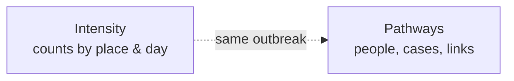
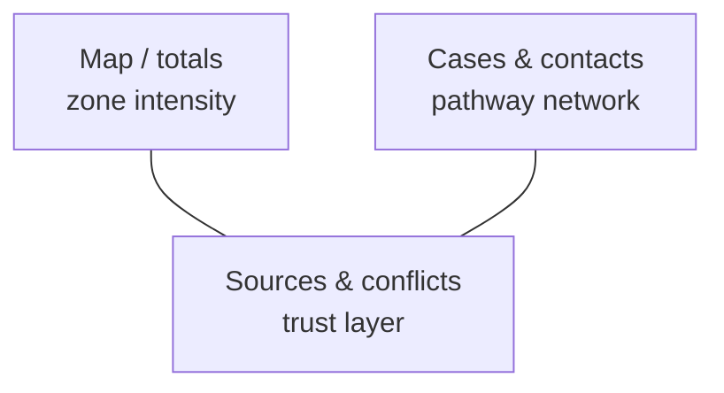
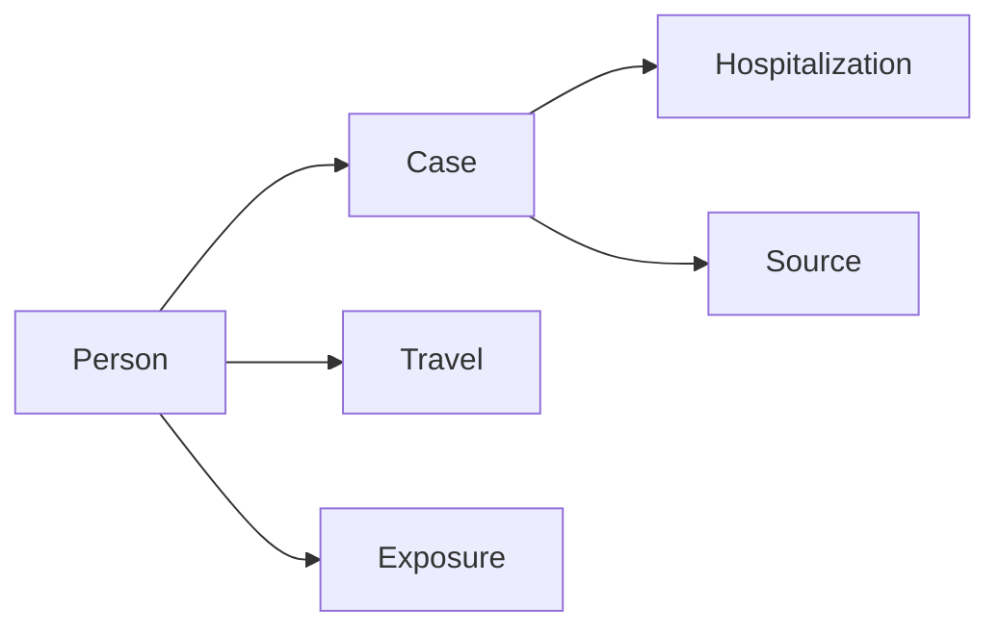
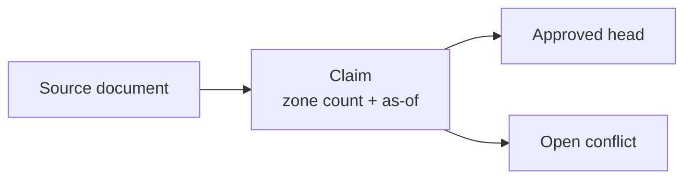
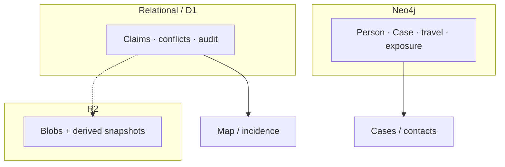
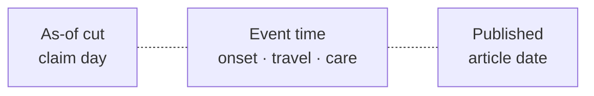
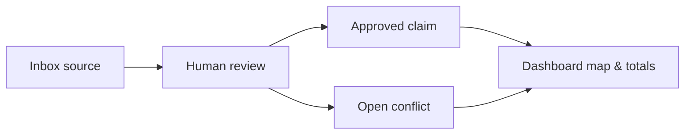

For table names, keys, and graph labels, see [Database structure](/docs/database-structure/).

## The questions an outbreak forces you to ask

Outbreak work asks two different kinds of questions. One is about **intensity**: how many cases in a place on a given day. The other is about **pathways**: who might have exposed whom, where people traveled, and how care unfolded.

| Question type | Example | What you need |
| --- | --- | --- |
| Intensity in place and time | “How many confirmed cases in Ituri as of 1 June?” | Comparable counts with a clear “as of” day |
| Pathways between people | “Did this contact travel after last exposure?” | Linked events: people, cases, travel, care |

Confusing these two questions produces maps that look precise but cannot support contact follow-up, or case networks that cannot answer “what did we know as of Tuesday?”

## What you already see on this dashboard

The [interactive dashboard](https://2026bdbv.diaphana.io/app) already shows both kinds of picture.

| On the dashboard | Modeling role |
| --- | --- |
| Map and country totals | Zone-level intensity — curated counts for a chosen as-of day |
| Cases, contacts, timeline pins and links | Individual pathways — who fell ill, who was exposed, how events line up |
| Sources and open conflicts | Evidence layer — claims stay visible until a human resolves disagreement |

You do not need to know the databases yet: the UI already separates “how many here” from “how did this person connect to that case.”

## Why pathways need a network

Contact tracing and travel stories are **relational**. A person can have more than one case episode; a case can cite several sources; exposure is a window of possible contact, not a single checkbox. Tables of rows struggle when the question is “walk the edges” rather than “sum a column.”

| Modeling task | Why a network helps |
| --- | --- |
| Reconstruct exposure chains | Edges carry first/last contact dates between people and cases |
| Follow mobility | Travel legs attach to people and places in order of departure and arrival |
| Align care with illness | Hospitalization intervals hang off the same case episode |
| Cite evidence on a case | Cases point at source documents without flattening the timeline |

That network of people, cases, travel, exposure, and care is stored in a **graph database (Neo4j)**. Graph storage matches how infectious-disease models reason about transmission and mobility: nodes for entities, edges for relationships with dates.

## Why zone counts stay in tables

Zone1 counts — “confirmed / deaths for this admin unit as of this day” — are **tabular assertions**. They need fingerprints, review status, version lineage, and conflict pairs. Modelers and curators care about:

| Need | Why a table fits |
| --- | --- |
| As-of slices | Compare like with like: latest approved head with `as_of` ≤ query day |
| Approve / revise | Append versions; supersede without erasing history |
| Visible conflicts | Same place, same claim type, same as-of, two incompatible values |

Those claim rows live in a **relational store (SQL on Cloudflare D1)** — the natural home for fingerprints, indexes, and audit events. Intensity time series should not wait on walking a case graph.

## Two stores, one outbreak picture

**Claims** (zone1 counts and Curate tabular artifacts) → relational / D1.  
**Cases** (person–case–travel–exposure–care network) → Neo4j.

| Store | Holds | Serves |
| --- | --- | --- |
| Relational (D1) | Zone1 count claims, conflicts, curation audit | Map heads, incidence series, Curate inbox |
| Graph (Neo4j) | Person, Case, travel, exposure, care, outbreak envelope | Case detail, contact pathways, mobility |
| Object storage (R2) | Source blobs and derived read snapshots | Fast map/curate reads (derived, not approval truth) |

Schemas, keys, and edges are spelled out on [Database structure](/docs/database-structure/). The split is intentional: one source of truth per kind of fact, one outbreak picture in the product.

## Three clocks

Infectious-disease data fail when clocks are mixed. The dashboard keeps them distinct.

| Clock | Typical fields | Use |
| --- | --- | --- |
| Epidemiological cut | Claim as-of date | “Numbers as of this day” for maps and conflict keys |
| Event / reporting time | Onset, last contact, admission, classification | Individual timelines and follow-up windows |
| Document time | Source published / retrieved | When the article appeared — **not** the fact cut |

Never treat “when the article ran” as “the count as of that day.” Aggregate queries are as-of slices; case views are event sequences.

## Trust and curation

Modeling only helps if the evidence layer is honest.

| Practice | Why it matters |
| --- | --- |
| Human approve / reject | Production numbers come from curated, approved claims |
| Conflicts stay visible | Disagreement is not hidden until a curator resolves it |
| Automated extract gated | Extract stays off in production until a backend design is approved |

For live maps and curated claims, open the [dashboard](https://2026bdbv.diaphana.io/app). For how Claim and Case are stored, continue to [Database structure](/docs/database-structure/).
