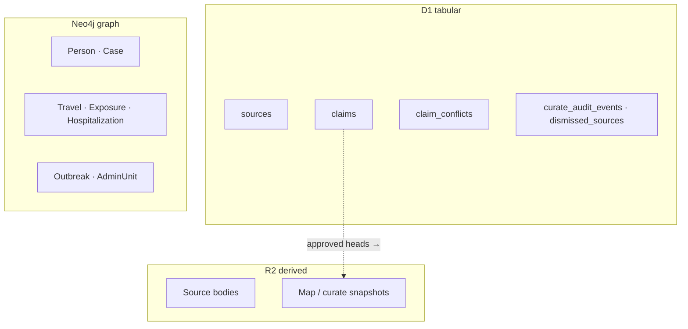
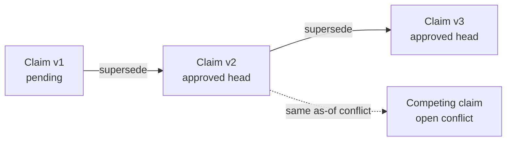
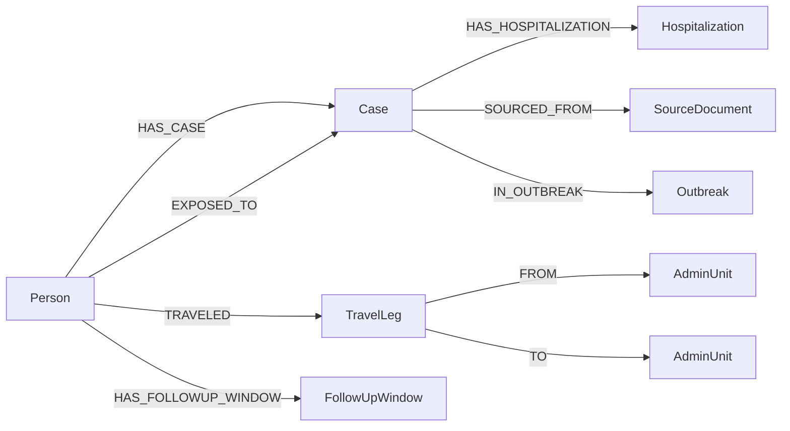

Modeling rationale (why two stores help outbreak work) is on [Data and storage](/docs/data-and-storage/). This page is the technical picture of **target** persistence: Claims on Cloudflare D1, Cases on Neo4j.

## Source-of-truth split

| Store | Source of truth | Not for |
| --- | --- | --- |
| **D1** | Curate tabular: sources, claims (zone1 count assertions), claim conflicts, curate audit events, dismissed sources; future extract/classify job rows | Case graph; raw HTML/PDF bodies |
| **Neo4j** | Case graph: Person, Case, TravelLeg, Hospitalization, Exposure, FollowUp, Facility, Outbreak, related relationships; geographic AdminUnit master (for now) | Claim / SourceDocument / ClaimConflict / CurateAuditEvent after Claim migration |
| **R2** | Source blobs + derived read snapshots (inbox / conflicts / map claim JSON) | Approval SoT — Claims always approve on D1 |

**Target rule:** no long-lived dual source of truth for the same claim. Map / incidence read approved claims from D1 (or a D1-derived R2 snapshot). Case layers stay on Neo4j.

## Claim store (D1 / relational)

**Role:** zone1 count assertions and Curate tabular artifacts — fingerprints, review status, lineage versions, conflicts, audit. Claims do not need a graph SoT.

### Tables (conceptual)

| Table | Role |
| --- | --- |
| `sources` | Curated / inbox source documents (`normalized_url`, publish/retrieve metadata) |
| `claims` | Atomic assertion: fingerprint, `subject_ref` (zone1 code string), `as_of_date`, lineage/version, review status, confidence, claim type/category, object value |
| `claim_conflicts` | Incompatible claim pair for the same type + subject + as-of |
| `curate_audit_events` | Approve / reject / revise / rollback chronology |
| `dismissed_sources` | Rejected inbox URLs |

Indexes called out for Curate and Map: `normalized_url` on sources; claim **fingerprint**; **`lineage_id`**; **`as_of_date`** (and subject/type combinations used for conflict keys and as-of heads).

`subject_ref` is a **zone1 admin code string**. Geographic AdminUnit master may remain Neo4j or static JSON — there is **no mandatory foreign key** from D1 claims into Neo4j.

### Claim fields

| Meaning | Field (technical) |
| --- | --- |
| Stable content hash for dedupe | `fingerprint` |
| Place the count is about (zone1 code) | `subject_ref` |
| Epidemiological cut day | `as_of_date` |
| Logical claim family across revisions | `lineage_id` |
| Revision number within lineage | `version` |
| Review workflow | review status (`pending` / approved / rejected, …) |
| Strength of evidence | `confidence` |
| Fine type (e.g. `case_count`, `incidence`) | `claim_type` |
| Coarse bucket for queues / Map | `claim_category` (e.g. `aggregate_count`) |
| Structured count payload | `object_value` |
| Provenance to source row | source id / FK to `sources` |

### Lineage figure

Append-only revisions keep history; Map reads the **approved head** with `as_of_date ≤` query day. Conflicts remain visible until resolved.

## Case store (Neo4j / graph)

**Role:** Person–Case–travel–exposure–care network for individual epidemiology. Time is first-class on almost every fact.

### Labels and key properties

| Label | Purpose | Key temporal / identity |
| --- | --- | --- |
| **Outbreak** | Whole event envelope | `declared_at`, `ended_at`, incubation / follow-up bounds |
| **Person** | Human (`role`: case, contact, …) | `date_of_reporting` |
| **Case** | Case episode under a Person | onset, reporting, classification; isolation / outcome when known; `admin0_iso` for Map |
| **TravelLeg** | Movement | `departed_at`, `arrived_at` |
| **Hospitalization** | Admission spell | `admitted_at`, `discharged_at` |
| **FollowUpWindow** | Monitoring window | `window_start` ← last contact; `window_end` |
| **Facility** | Hospital / lab / ETU | place durable |
| **AdminUnit** | Country / province master | `tracking_mode`; Claim `subject_ref` aligns by code string |

Exposure is modeled primarily as **`EXPOSED_TO` relationship properties** (`date_of_first_contact`, `date_of_last_contact`) rather than a separate Exposure node in current seed.

### Relationships

| Relationship | From → To | Notes |
| --- | --- | --- |
| `HAS_CASE` | Person → Case | Case episode under a person |
| `EXPOSED_TO` | Person → Case \| Person \| Event | First + last contact possibility dates |
| `TRAVELED` / `FROM` / `TO` | Person → TravelLeg → AdminUnit \| POE | Ordered mobility |
| `HAS_HOSPITALIZATION` | Case → Hospitalization | Care interval |
| `HAS_FOLLOWUP_WINDOW` | Person → FollowUpWindow | Follow-up from last contact when configured |
| `SOURCED_FROM` | Case → SourceDocument | Case cites sources by internal id |
| `IN_OUTBREAK` | Case → Outbreak | Event membership |
| `DETECTED_IN` / `RESIDES_IN` / `DIED_IN` | Case → AdminUnit | Place roles (designed; may be sparse in seed) |
| `BECAME_CASE` | Person → Case | Contact conversion (designed) |
| `INCLUDES_ADMIN` | Outbreak → AdminUnit | Affected geography |

Claim-side edges (`Claim`-`FROM`-`SourceDocument`, `SUPERSEDES`, `CONFLICTS_WITH`) are **legacy on Neo4j** during migration; **target SoT for Claims is D1** (see above).

### Time fields that matter for modeling

| Axis | Fields | Rule of thumb |
| --- | --- | --- |
| Event time | onset, departed/arrived, admitted, first/last contact | Individual timelines |
| Administrative time | classification, reporting, isolation, outcome | When authorities recorded a state |
| Validity interval | FollowUp `window_start` / `window_end` | Inclusive active period |
| Document time | Source `published_at`, `retrieved_at` | Not the claim as-of cut |

Same-day exposure sets first and last contact equal. Follow-up windows start from **last** contact when the outbreak is configured that way.

## Cross-links between stores

| Link | How |
| --- | --- |
| Shared source identity | Internal source ids appear on case `SOURCED_FROM` / `source_ids` and on D1 `sources` / claim provenance |
| Map intensity | Approved claims from **D1** (or D1-derived R2 snapshot) |
| Case / contact layers | **Neo4j** graph reads |
| Geography | Claim `subject_ref` zone1 **string**; AdminUnit master may live in Neo4j without a hard FK |

Do not keep two approval truths for the same claim. Snapshots on R2 are **derived** read models, not Curate SoT.

## What this page is not

- **Why** this split helps infectious-disease modeling → [Data and storage](/docs/data-and-storage/).
- Curate write path / Claim D1 migration / Bolt serving for Curate → private `diaphana-io/2026bdbv-curate` (OSS Map only reads shared D1 + Neo4j).
